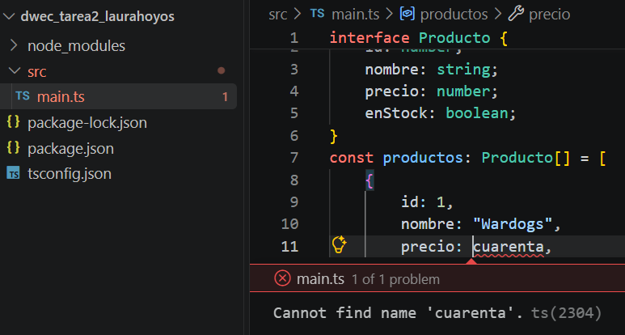

# Tarea 2: Configuración del Entorno y Transpilación con TypeScript
Ejercicio práctico del módulo DWEC (RA1) para configurar Node.js, instalar TypeScript, trabajar con interfaces y tipos, y transpilar código a JavaScript.

## 🚀 Resultado Visual


## 🛠️ Tecnologías utilizadas
- TypeScript / JavaScript / HTML5
- Node.js & npm
- Visual Studio Code

## 📋 ¿Qué se hizo? (Funcionalidades)
- Configuración del entorno con Node.js, npm y TypeScript (`tsconfig.json`).
- Creación de la interfaz `Producto` y un array con 4 elementos.
- Implementación de la función `calcularTotalStock` para sumar productos disponibles.
- Pruebas de tipado estático y detección de errores en TypeScript.
- Transpilación del código (`npx tsc`) y ejecución en navegador mediante `index.html`.

## ⚙️ Cómo ejecutarlo localmente
1. Abre la terminal en la raíz del proyecto.
2. Transpila el código TypeScript ejecutando:
   ```bash
   npx tsc
   ```
3. Abre el archivo `index.html` en el navegador y revisa la Consola (F12).
