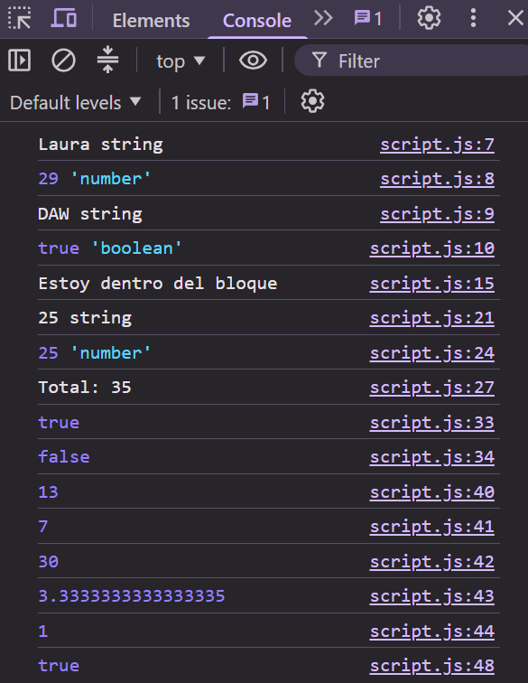

# Tarea 3: Variables, Conversión de Tipos e Igualdad Estricta en JavaScript

Práctica del módulo DWEC (RA2) enfocada en la sintaxis básica de JavaScript, comprobación del ámbito de bloque (let/const), conversión explícita de tipos, operadores y diferencias entre igualdad débil (==) e igualdad estricta (===).

## 🚀 Resultado Visual

## 🛠️ Tecnologías utilizadas

- JavaScript (ES6+)
- HTML5
- Visual Studio Code

## 📋 ¿Qué se hizo? (Funcionalidades)

- Declaración y verificación de variables con let, const y uso del operador typeof.
- Comprobación del ámbito de bloque de variables declaradas con let.
- Conversión explícita de cadenas de texto a números utilizando Number().
- Demostración de las diferencias entre la igualdad débil (==) y la estricta (===).
- Uso de operadores aritméticos (suma, resta, multiplicación, división, módulo) y lógicos (&&).

## ⚙️ Cómo ejecutarlo localmente
1. Abre el archivo index.html en cualquier navegador web.
2. Abre las Herramientas de Desarrollador pulsando F12.
3. Revisa la pestaña Consola para ver el resultado de la ejecución del script.