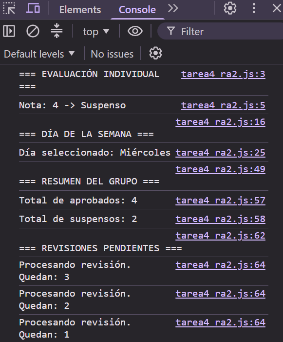

# TAREA 4 (RA2): Estructuras de Control de Flujo y Recorrido de Colecciones
Estructuras de decisión (`if...else`, `switch`) y bucles (`for...of`, `do...while`) en JavaScript ejecutados en el navegador.

## 🚀 Resultado Visual

## 🛠️ Tecnologías utilizadas
- JavaScript (ES6)
- HTML5
- Visual Studio Code / Visual Studio IDE

## 📋 ¿Qué se hizo? (Funcionalidades)
- **Evaluación de notas (`if...else if...else`):** Clasificación de notas según rangos numéricos.
- **Día de la semana (`switch`):** Selección de días según su código numérico (1-7) con `default`.
- **Recorrido de colecciones (`for...of`):** Conteo de aprobados y suspensos iterando un array.
- **Bucle diferido (`do...while`):** Procesamiento de revisiones pendientes asegurando una ejecución mínima.
- **Pruebas y modificaciones:** Variación de parámetros para comprobar la reactividad en la consola (F12).

## ⚙️ Cómo ejecutarlo localmente
1. Clona o descarga el proyecto.
2. Abre el archivo `index.html` en cualquier navegador web.
3. Abre las **Herramientas de Desarrollador (F12)** y selecciona la pestaña **Consola**.