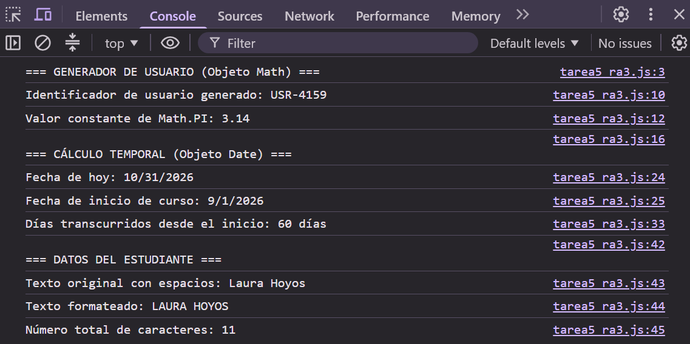

# TAREA 5 (RA3): Calculadora Temporal y Matemática con Objetos Nativos (Math y Date)
Uso de los objetos nativos `Math`, `Date` y `String` en JavaScript para generar identificadores aleatorios, realizar cálculos temporales y formatear textos.

## 🚀 Resultado Visual

## 🛠️ Tecnologías utilizadas
- JavaScript (ES6)
- HTML5
- Visual Studio Code / Visual Studio IDE

## 📋 ¿Qué se hizo? (Funcionalidades)
- **Generador de identificadores (`Math.random()` y `Math.floor()`):** Generación de identificadores numéricos aleatorios entre 1000 y 9999.
- **Valor de PI (`Math.PI` y `toFixed()`):** Obtención y redondeo del valor de PI a dos decimales.
- **Gestión de fechas (`Date`):** Obtención de la fecha actual y creación de una fecha de inicio de curso.
- **Cálculo temporal (`getTime()`):** Cálculo de los días transcurridos desde el inicio del curso mediante la diferencia en milisegundos.
- **Formateo de texto (`trim()` y `toUpperCase()`):** Eliminación de espacios sobrantes y conversión del nombre del estudiante a mayúsculas.
- **Longitud de texto (`length`):** Obtención del número total de caracteres del nombre formateado.
- **Pruebas y modificaciones:** Cambios en la fecha de inicio, el nombre del estudiante y los decimales de PI para comprobar los resultados en la consola (F12).

## ⚙️ Cómo ejecutarlo localmente
1. Clona o descarga el proyecto.
2. Abre el archivo `index.html` en cualquier navegador web.
3. Abre las **Herramientas de Desarrollador (F12)** y selecciona la pestaña **Consola**.