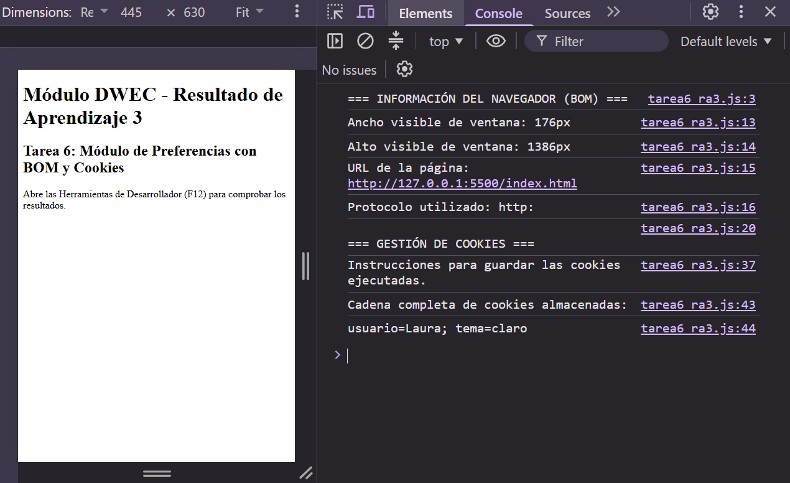
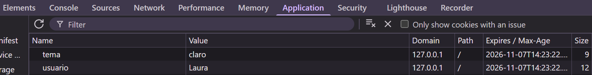

# Tarea 6: Módulo de Preferencias con BOM y Cookies

Desarrollo de un módulo de preferencias en JavaScript utilizando el BOM (`window`, `location`) y cookies para almacenar y recuperar información del usuario.

## 🚀 Resultados Visuales

- **Ejecución y comprobación de información del navegador en la consola:**  
  

- **Panel de preferencias con cookies:**  
  

## 🛠️ Tecnologías utilizadas

- HTML5
- CSS3
- JavaScript
- BOM (`window` y `location`)
- Cookies (`document.cookie`)
- Visual Studio Code
- Live Server

## 📋 ¿Qué se hizo? (Funcionalidades)

- **Información de pantalla:** obtención del ancho y alto de la ventana mediante `window.innerWidth` y `window.innerHeight`.
- **Información de navegación:** consulta de la URL y el protocolo mediante `location.href` y `location.protocol`.
- **Preferencias del usuario:** almacenamiento del nombre y tema preferido mediante cookies.
- **Gestión de cookies:** creación, lectura y recuperación de cookies utilizando `document.cookie`.
- **Persistencia:** configuración de una duración de 7 días para las cookies.
- **Personalización:** nombre de usuario "Laura" y tema preferido "claro".

## ⚙️ Cómo ejecutarlo localmente

1. Abrir la carpeta del proyecto en Visual Studio Code.
2. Abrir el archivo `index.html`.
3. Ejecutar el proyecto mediante la extensión Live Server.
4. Acceder desde el navegador a:

   `http://127.0.0.1:5500/index.html`

## 📝 Observaciones

Las preferencias se almacenan en cookies para poder recuperarlas en posteriores visitas. Se utilizan las propiedades del BOM para consultar información de la ventana y del navegador.