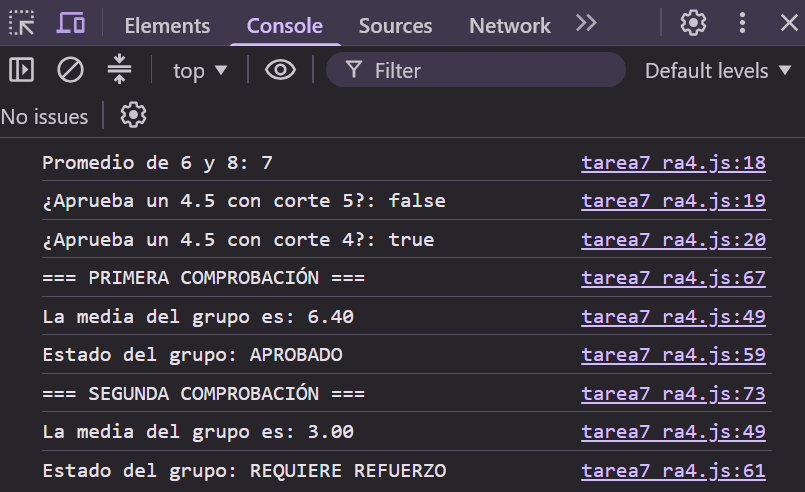

# TAREA 7 (RA4): Librería de Utilidades - Estadísticas con Callbacks
Procesamiento de calificaciones mediante funciones flecha, parámetros por defecto, iteración de arrays y la implementación de callbacks en JavaScript para comunicar resultados y evaluar grupos.

## 🚀 Resultado Visual

## 🛠️ Tecnologías utilizadas
- JavaScript (ES6)
- HTML5
- Visual Studio Code / Visual Studio IDE

## 📋 ¿Qué se hizo? (Funcionalidades)
- **Funciones flecha y parámetros por defecto:** Definición de `calcularPromedio` y `esAprobado`, implementando valores predeterminados para la nota de corte (`notaCorte = 5`).
- **Procesamiento de arrays y callbacks:** Implementación de `procesarListaNotas` para recorrer arrays de notas (`for...of`), calcular medias acumuladas y transmitir los resultados a funciones callback externas.
- **Callbacks de presentación y evaluación:** Creación de `mostrarMedia` (uso de `toFixed(2)`) y `evaluarGrupo` (control de flujo con `if/else` basado en `esAprobado`).
- **Documentación JSDoc:** Documentación estructurada de cada una de las 5 funciones del script detallando `@param` y `@returns`.
- **Pruebas y comprobaciones:** Evaluación del comportamiento con diferentes listas de calificaciones (`[4, 7.5, 8, 3.5, 9]` y `[2, 3, 4, 5, 1]`) y validación de la sobreescritura del parámetro de corte (`esAprobado(4.5, 4)`).

## ⚙️ Cómo ejecutarlo localmente
1. Clona o descarga el proyecto.
2. Abre el archivo `index.html` en cualquier navegador web.
3. Abre las **Herramientas de Desarrollador (F12)** y selecciona la pestaña **Consola**.