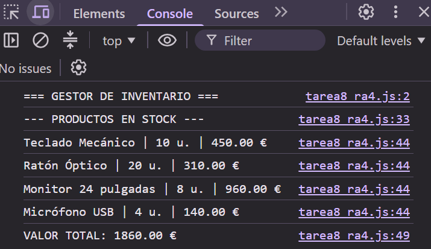

# TAREA 8 (RA4): Gestor de Inventario con Clases y Arrays
Implementación de una estructura de inventario orientada a objetos en JavaScript mediante clases, constructores, métodos de cálculo, instanciación con `new` e iteración sobre arrays con `forEach()`.

## 🚀 Resultado Visual

## 🛠️ Tecnologías utilizadas
- JavaScript (ES6)
- HTML5
- Visual Studio Code / Visual Studio IDE

## 📋 ¿Qué se hizo? (Funcionalidades)
- **Definición de clase y constructor:** Creación de la clase `Producto` con propiedades inicializadas (`nombre`, `precio`, `cantidad`) mediante `this`.
- **Métodos encapsulados (`calcularSubtotal`):** Cálculo del subtotal por producto multiplicando precio unitario por existencias.
- **Instanciación y estructura de array:** Creación del array `inventario` instanciando objetos con la palabra clave `new`.
- **Recorrido eficiente con `forEach()`:** Iteración del array para calcular y formatear automáticamente el valor de stock de cada producto usando *template literals* y `toFixed(2)`.
- **Acumulación de totales:** Suma iterativa del total general del almacén.
- **Modificaciones realizadas:** Actualización del stock del monitor a 8 unidades (alcanzando 1720.00 € de total base), inclusión de un cuarto producto ("Micrófono USB"), cambio del título visible del HTML e inclusión de documentación interna.

## ⚙️ Cómo ejecutarlo localmente
1. Clona o descarga el proyecto.
2. Abre el archivo `index.html` en cualquier navegador web.
3. Abre las **Herramientas de Desarrollador (F12)** y selecciona la pestaña **Consola**.